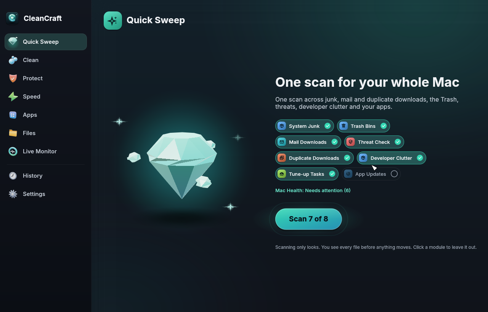

# CleanCraft

An original macOS cleaner and maintenance app, written in Rust (egui), with a command line tool and an MCP server for AI agents.



## What it does

- **Quick Sweep**: one scan across System Junk, Trash Bins, Mail Downloads, Threat Check, duplicate downloads, developer clutter, tune-up suggestions and app updates. Pick the modules to include.
- **Clean**: System Junk, Mail Downloads, Trash Bins, Developer Clutter (old Rust `target/`, `node_modules`, Python environments, unused simulators).
- **Protect**: Threat Check and Privacy Traces.
- **Speed**: Tune-up Tasks and Startup Items.
- **Apps**: App Remover (with leftovers, several apps at once) and App Updates.
- **Files**: Large & Old Files, Duplicates, Similar Images, Disk Map.
- **Live Monitor and Mac Health**: CPU, memory, storage, battery, network, recommendations and free space history.
- **Menu bar agent** (optional): a small icon that opens a live panel (CPU, memory, disk, battery, network, busiest apps, what waits for review), scheduled scans (look only) and notifications.

Every list has search, filters and sorting. The full feature contract, with the status of each feature, is in [docs/FEATURES.md](docs/FEATURES.md).

## Safety

- Every cleanup shows a preview first: the exact files, sizes and the reason. Nothing moves until you confirm that list.
- Removing means moving to the Trash or a restorable quarantine; CleanCraft itself never deletes anything for good. Emptying the Trash and erasing Mail's deleted messages are done by Finder and Mail, only after you confirm the exact list. Every action is logged in History with Undo where undo is possible.
- Each feature has a fixed list of allowed locations. System files, iCloud and Photos libraries, the contents of Documents and Desktop, and files open in running apps are never touched.
- Background parts (menu bar agent, schedules, watchers) only scan and notify. They never clean.
- Tests run only on a fake home folder in a temporary directory.

## Install (on a Mac)

Requirements: macOS 11 or later, the Rust toolchain (`rustup`).

```
git clone https://github.com/cristianizzo/cleancraft.git
cd cleancraft
bash scripts/install-app.sh
```

This builds the app, installs `/Applications/CleanCraft.app` and links the `cleancraft` command in `~/.local/bin`. The app is signed ad hoc: the first time, macOS may ask you to allow it in System Settings > Privacy & Security.

### Updates

CleanCraft updates itself from GitHub Releases. It looks for a new version at most once a day (from the menu bar agent, or when the app opens) and shows "Update available" with what is new; Install downloads the Apple silicon disk image, checks its SHA-256 and signature, moves the current app to the Trash (History can put it back) and restarts. Turn on Settings > Updates > "Install updates automatically" to skip the click, or use `cleancraft update --check` and `cleancraft update --install` from your own schedule. An app built from source with `scripts/install-app.sh` updates the same way; a build newer than the latest release says "You are ahead of the latest release" and installs nothing.

For the full experience, grant Full Disk Access (and App Management to remove App Store apps) in System Settings > Privacy & Security. CleanCraft explains each one when it needs it.

## AI agents

`cleancraft serve` runs an MCP server. Agents can scan and preview; cleaning stays off until you allow it in Settings, and even then every run needs the confirmed preview. See [docs/guide-ai-agents.md](docs/guide-ai-agents.md).

## Develop

```
cargo test --workspace
cargo clippy --workspace --all-targets -- -D warnings
cargo fmt --all
```

Project rules for contributors and agents: [CLAUDE.md](CLAUDE.md) and [docs/agents/STANDARD.md](docs/agents/STANDARD.md).

## License

MIT OR Apache-2.0.
